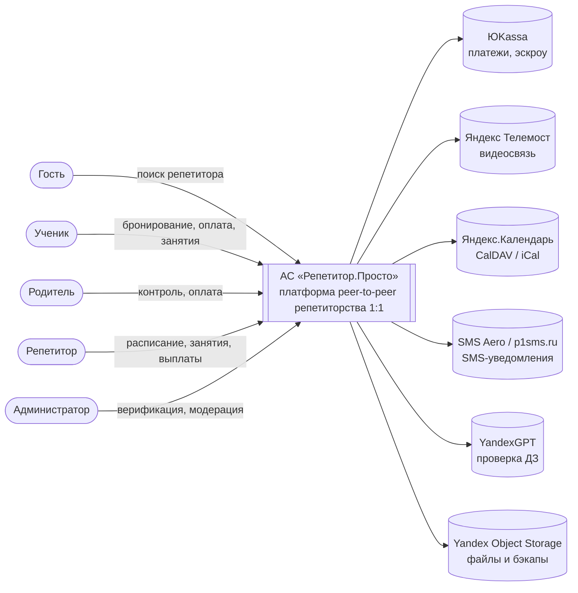
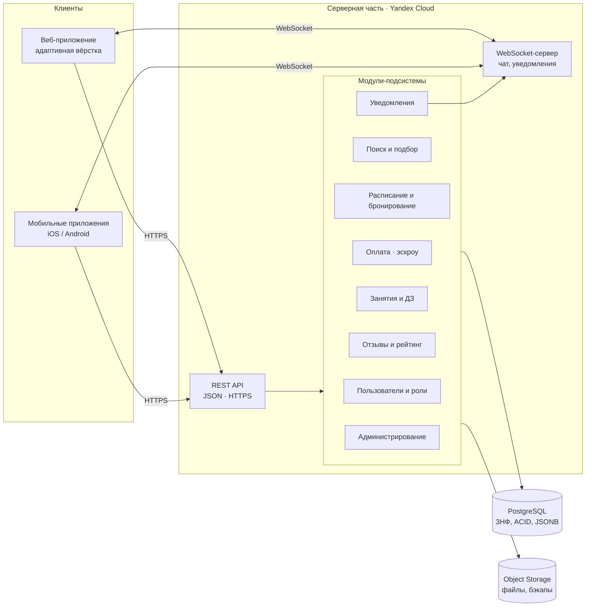

# Архитектура АС «Репетитор.Просто»

Описание составлено по ТЗ (разд. 3.2, 4.1.1, 4.2.1, 4.3) в нотации модели C4: уровень 1 — контекст системы, уровень 2 — контейнеры и модули. Диаграммы записаны на Mermaid («диаграммы как код») и отображаются прямо в GitHub.

## Уровень 1. Контекст системы

## Уровень 2. Контейнеры и модули

## Модули и их взаимодействие

| Модуль | Назначение (по ТЗ) | Взаимодействует с | Эпик |
|---|---|---|---|
| Пользователи и роли | Регистрация, аутентификация, роли, личные кабинеты, верификация | все модули (проверка прав), Object Storage | Подсистема управления пользователями |
| Поиск и подбор | Каталог, фильтры, ранжирование, профиль репетитора | Расписание (свободные слоты), Отзывы (рейтинг) | Подсистема поиска и подбора |
| Расписание и бронирование | Слоты AvailabilitySlot, бронирование с блокировкой, отмена | Оплата, Уведомления, Яндекс.Календарь | Подсистема расписания и бронирования |
| Оплата (эскроу) | Заморозка, выплата, возврат, раздел «Финансы» | ЮKassa, Бронирование, Уведомления | Подсистема оплаты |
| Проведение занятий | Видеосессия, доска, чат, ДЗ, проверка ИИ | Яндекс Телемост, YandexGPT, Object Storage, WebSocket | Подсистема проведения занятий |
| Отзывы и рейтинг | Отзыв после занятия, пересчёт рейтинга | Поиск, Администрирование (модерация) | Обратная связь и уведомления |
| Уведомления | Push / SMS / Email по событиям, повторная отправка | SMS Aero, WebSocket, все событийные модули | Обратная связь и уведомления |
| Администрирование | Верификация, блокировка, модерация, отчёты, мониторинг | Пользователи, Отзывы, БД | Администрирование и эксплуатация |

Обмен между клиентом и сервером — REST API (JSON) по HTTPS, функции реального времени — WebSocket (разд. 4.3.1 ТЗ).
